<!-- Header Wave Banner -->
<div align="center">


<!-- Animated Greeting -->
<a href="https://github.com/Isuru-CodeX">
  
</a>

<br/>

<!-- Animated Banner -->


<br/><br/>

<!-- Profile Badges -->

<a href="https://github.com/Isuru-CodeX?tab=followers"></a>
<a href="https://github.com/Isuru-CodeX?tab=repositories"></a>


<br/><br/>

<!-- Social Links -->
<a href="https://www.linkedin.com/in/isuru-rathnayaka-220484288/">
  
</a>
<a href="mailto:isururathnayaka999@gmail.com">
  
</a>
<a href="https://github.com/Isuru-CodeX">
  
</a>

</div>

---

<!-- Animated Divider -->


## 👨‍💻 About Me

<div align="center">


</div>

```typescript
const isuru: Developer = {
  name:     "Isuru Rathnayaka",
  role:     "Full-Stack Software Engineer & AI Builder",
  location: "🇱🇰 Sri Lanka",

  languages: [
    "Python 🐍", "TypeScript ⚡", "Java ☕", "PHP 🐘", "JavaScript"
  ],
  frameworks: [
    "FastAPI", "React 19", "Tailwind CSS 4",
    "Hibernate ORM", "React Native / Expo"
  ],
  currentlyBuilding: "CareerLens AI — Autonomous Career Co-Pilot",
  currentlyLearning: [
    "Real-Time Voice AI & Audio Processing",
    "Cloud Architecture (Docker · CI/CD)",
    "Scalable Distributed Systems",
  ],
  askMeAbout: [
    "FastAPI REST design", "React 19", "Java EE / MVC",
    "Database modeling", "AI/NLP integration",
  ],
  funFact: "I love turning caffeine ☕ + ideas 💡 into working products 🚀",
};
```

```diff
+ ai & voice co-pilots · web applications · mobile apps
+ rest apis · stripe e-commerce · database systems
+ zero-pii security · automated testing · devops & docker
- "it can't be done"
```

- 🔭 &nbsp;Currently architecting **[CareerLens AI](https://github.com/Isuru-CodeX/CareerLens)** — enterprise-grade AI career intelligence platform
- 🎙️ &nbsp;Built a **Real-Time Voice AI Mock Interview Simulator** with STAR scoring & live Web Audio VU meter
- 🌱 &nbsp;Diving deep into **distributed systems, Docker, and production-grade CI/CD pipelines**
- 🏆 &nbsp;Shipped **5 full-stack / AI projects** across Python, Java EE, PHP, and React Native
- 📫 &nbsp;Reach me on **[LinkedIn](https://www.linkedin.com/in/isuru-rathnayaka-220484288/)** or **isururathnayaka999@gmail.com**

<!-- Animated Divider -->


## 🌌 Core Engineering Ecosystem

<div align="center">

<p><i>Interactive surface matrix — everything I architect orbits real-time AI, performance, and clean code.</i></p>

     
    

</div>

<!-- Animated Divider -->


## 🛠️ Tech Stack & Tools

<div align="center">

### 💻 Languages & Frameworks


### 🗄️ Databases & Dev Tools


<br/><br/>

<!-- Framework Badges Row 1 -->


<br/>

<!-- Framework Badges Row 2 -->


</div>

<!-- Animated Divider -->


## 🚀 Featured Projects

<div align="center">

<!-- CareerLens AI - Full Width Flagship -->
<table>
  <tr>
    <td align="center" colspan="2">
      <a href="https://github.com/Isuru-CodeX/CareerLens">
        
      </a>
    </td>
  </tr>
  <tr>
    <td colspan="2" valign="top">
      <p><b>🎙️ <a href="https://github.com/Isuru-CodeX/CareerLens">CareerLens AI</a></b> &nbsp;</p>
      <p>Enterprise-grade Autonomous AI Career Co-Pilot & ATS Intelligence platform with <b>real-time Voice AI mock interviews</b> (STAR scoring + live Web Audio VU meter), 54-role trajectory comparator, Zero-PII GitHub/LinkedIn skill discovery, dense-vector RAG with 4-tier ATS stress-testing (Workday, Greenhouse, Taleo, Lever), streaming Cover Letter Studio, drag-and-drop Kanban board, and triple-theme system.</p>
      <p>
        
        
        
        
        
        
        
        
      </p>
      
      &nbsp;
      
    </td>
  </tr>
  <tr>
    <td width="50%" valign="top">
      <h3>🖥️ <a href="https://github.com/Isuru-CodeX/PowerRig">PowerRig</a></h3>
      <p>Full-featured PHP e-commerce platform for PC parts & gaming gear. Stripe checkout, wishlist, automated PDF invoice generation, and product management.</p>
      <p>
        
        
        
        
      </p>
      
    </td>
    <td width="50%" valign="top">
      <h3>📱 <a href="https://github.com/Isuru-CodeX/SmartTrade">SmartTrade</a></h3>
      <p>Java & Hibernate phone marketplace — seller listings, live search (Ctrl+K), server-side cart, wishlist, Stripe checkout, automated email notifications & full admin panel.</p>
      <p>
        
        
        
        
      </p>
      
    </td>
  </tr>
  <tr>
    <td width="50%" valign="top">
      <h3>📚 <a href="https://github.com/Isuru-CodeX/BookVerse">BookVerse</a></h3>
      <p>Java EE digital library portal with MVC, Front Controller & DAO patterns. Member portal, loan/reservation workflows, subscription plans, reviews, and admin dashboard.</p>
      <p>
        
        
        
        
      </p>
      
    </td>
    <td width="50%" valign="top">
      <h3>✅ <a href="https://github.com/Isuru-CodeX/Task-Tracker">Task-Tracker</a></h3>
      <p>Cross-platform mobile task manager built with React Native & Expo, backed by a Java Servlets + Hibernate ORM REST API and MySQL database.</p>
      <p>
        
        
        
        
      </p>
      
    </td>
  </tr>
</table>

</div>

<!-- Animated Divider -->


## 📊 GitHub Stats & Analytics

<div align="center">

<!-- Stats Cards Row -->

&nbsp;


<br/><br/>

<!-- Streak Stats Card -->


</div>

<!-- Animated Divider -->


## 📦 Repository Directory

<!--START_SECTION:repos-->
| 📦 Repository | 📝 Description | 💻 Language | ⭐ Stars | 🕒 Last Push |
|---|---|---|:---:|---|
| [**CareerLens**](https://github.com/Isuru-CodeX/CareerLens) | 🤖 Autonomous AI Career Co-Pilot & ATS Intelligence with Voice AI mock interviews | Python / TypeScript | 0 | - |
| [**SmartTrade**](https://github.com/Isuru-CodeX/SmartTrade) | 📱 Java & Hibernate phone marketplace with Stripe checkout & admin panel | Java | 0 | - |
| [**PowerRig**](https://github.com/Isuru-CodeX/PowerRig) | 🖥️ PHP e-commerce platform with Stripe, wishlist & PDF invoices | PHP | 0 | - |
| [**BookVerse**](https://github.com/Isuru-CodeX/BookVerse) | 📚 Java EE digital library with MVC & DAO patterns, loan & admin systems | Java | 0 | - |
| [**Task-Tracker**](https://github.com/Isuru-CodeX/Task-Tracker) | ✅ React Native + Expo mobile task manager with Java Hibernate REST backend | TypeScript | 0 | - |
<!--END_SECTION:repos-->

<!-- Animated Divider -->


## 📈 Contribution Activity

<div align="center">

<!-- Contribution Heatmap -->


<sub>🌱 Keep the green squares coming!</sub>

</div>

<!-- Animated Divider -->


## 🏆 Achievements & Badges

<div align="center">


<br/><br/>


</div>

<!-- Animated Divider -->


## 🐍 Contribution Snake

<div align="center">

<picture>
  <source media="(prefers-color-scheme: dark)" srcset="https://raw.githubusercontent.com/Isuru-CodeX/Isuru-CodeX/output/github-snake-dark.svg" />
  <source media="(prefers-color-scheme: light)" srcset="https://raw.githubusercontent.com/Isuru-CodeX/Isuru-CodeX/output/github-snake.svg" />
  
</picture>

</div>

<!-- Animated Divider -->


## 🔁 My Engineering Process

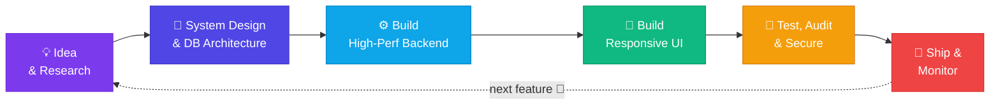

<!-- Animated Divider -->


## 🗺️ Goals & Milestones

<div align="center">

```
╔══════════════════════════════════════════════════════════════════════╗
║                    🏆  ISURU'S ROADMAP  🏆                          ║
╠══════════════════════════════════════════════════════════════════════╣
║  ✅  Shipped 5 full-stack & AI projects                             ║
║  ✅  Built real-time Voice AI with STAR scoring & VU meter          ║
║  ✅  Mastered MVC, DAO & Front Controller patterns in Java EE       ║
║  ✅  Implemented ATS stress-testing with 4-tier engine              ║
║  🔲  Cloud containerisation & CI/CD (Docker · GitHub Actions)      ║
║  🔲  Automated end-to-end testing across all production projects    ║
║  🔲  Deploy live cloud-hosted demo of CareerLens AI                 ║
║  🔲  Build & publish an open-source Python library                  ║
╚══════════════════════════════════════════════════════════════════════╝
```

</div>

<!-- Animated Divider -->


## 💬 Dev Quote of the Day <sup><sub>(changes daily)</sub></sup>

<!--START_SECTION:quote-->
> 💬 *"Talk is cheap. Show me the code."*
>
> **— Linus Torvalds**
<!--END_SECTION:quote-->

<!-- Animated Divider -->


## 🤝 Open To Collaborate

<div align="center">


<br/><br/>


</div>

<br/>

| 💼 Platform | 🔗 Link |
|---|---|
| 🔵 LinkedIn | [isuru-rathnayaka-220484288](https://www.linkedin.com/in/isuru-rathnayaka-220484288/) |
| 🐙 GitHub | [@Isuru-CodeX](https://github.com/Isuru-CodeX) |
| 📧 Email | `isururathnayaka999@gmail.com` |

---

<div align="center">


<br/>

<a href="https://www.linkedin.com/in/isuru-rathnayaka-220484288/">
  
</a>
&nbsp;
<a href="mailto:isururathnayaka999@gmail.com">
  
</a>

<br/><br/>


</div>
