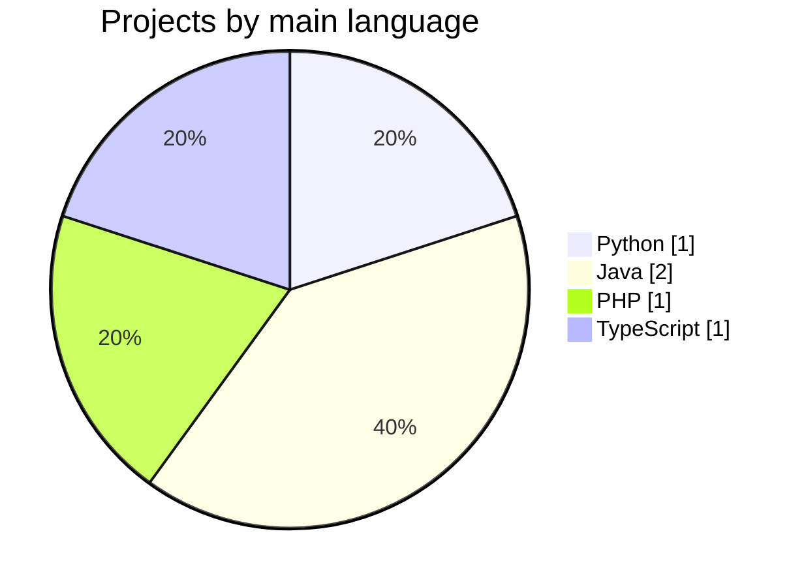
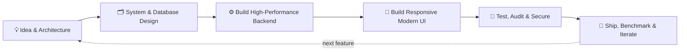

<div align="center">


<a href="https://github.com/Isuru-CodeX">
  
</a>

<br/><br/>


<a href="https://github.com/Isuru-CodeX?tab=followers"></a>
<a href="https://github.com/Isuru-CodeX?tab=repositories"></a>

<br/><br/>

<a href="https://www.linkedin.com/in/isuru-rathnayaka-220484288/"></a>
<a href="mailto:isururathnayaka999@gmail.com"></a>
<a href="https://github.com/Isuru-CodeX"></a>

</div>

---

## 👨‍💻 About Me

```js
const isuru = {
  name: "Isuru Rathnayaka",
  role: "Full-Stack Software Engineer",
  focus: ["Python / FastAPI", "React & TypeScript", "Java EE / Hibernate", "PHP", "MySQL"],
  building: "AI career co-pilots, e-commerce platforms, and web & mobile applications",
  currentlyImproving: ["Real-time Voice AI & Audio Processing", "Cloud Architecture & Scalability", "Clean Code & Automated Testing"],
  funFact: "I love turning ideas into high-impact working products ⚡",
};
```

- 🔭 Architecting & building full-stack applications with **Python (FastAPI), React 19, TypeScript, Java EE, and PHP**
- 🎙️ Flagship release: **[CareerLens AI](https://github.com/Isuru-CodeX/CareerLens)** — Autonomous Career Co-Pilot with real-time Voice AI mock interviews and ATS intelligence
- 🌱 Currently exploring **Real-Time Voice AI, NLP systems, and scalable distributed architectures**
- 💬 Ask me about **FastAPI, React, Java EE / Hibernate, RESTful API design, and database modeling**
- 📫 Reach me on **[LinkedIn](https://www.linkedin.com/in/isuru-rathnayaka-220484288/)** or via email at **isururathnayaka999@gmail.com**

---

## 🛠️ Tech Stack

<div align="center">


<br/>


<br/><br/>


</div>

---

## 🚀 Featured Projects

<table>
  <tr>
    <td colspan="2" width="100%" valign="top">
      <h3>🎙️ <a href="https://github.com/Isuru-CodeX/CareerLens">CareerLens AI</a> &nbsp;<sub></sub></h3>
      <p>Autonomous AI Career Co-Pilot & ATS Intelligence platform. Features real-time Voice AI mock interview simulation with STAR scoring & live Web Audio VU meter, heuristic resume ATS audit, semantic skill-gap matching, and streaming cover letter studio.</p>
      <p>
        
        
        
        
        
        
        
      </p>
      
    </td>
  </tr>
  <tr>
    <td width="50%" valign="top">
      <h3>🖥️ <a href="https://github.com/Isuru-CodeX/PowerRig">PowerRig</a></h3>
      <p>PC parts and gaming gear e-commerce with Stripe checkout, wishlist and automated PDF invoices.</p>
      <p>
        
        
        
      </p>
      
    </td>
    <td width="50%" valign="top">
      <h3>📱 <a href="https://github.com/Isuru-CodeX/SmartTrade">SmartTrade</a></h3>
      <p>Phone marketplace with seller listings, live search (Ctrl+K), server-side cart and wishlist.</p>
      <p>
        
        
        
      </p>
      
    </td>
  </tr>
  <tr>
    <td width="50%" valign="top">
      <h3>📚 <a href="https://github.com/Isuru-CodeX/BookVerse">BookVerse</a></h3>
      <p>Online library portal built with MVC, Front Controller and DAO patterns, with a member portal and admin dashboard.</p>
      <p>
        
        
        
      </p>
      
    </td>
    <td width="50%" valign="top">
      <h3>✅ <a href="https://github.com/Isuru-CodeX/Task-Tracker">Task-Tracker</a></h3>
      <p>Cross-platform mobile task manager with a Java Servlets and Hibernate REST backend.</p>
      <p>
        
        
        
      </p>
      
    </td>
  </tr>
</table>

---

## 🔄 Latest Repositories <sup><sub>(auto-updated)</sub></sup>

<!--START_SECTION:repos-->
| 📦 Repository | 📝 Description | 💻 Language | ⭐ Stars | 🕒 Last push |
|---|---|---|:---:|---|
| [**CareerLens**](https://github.com/Isuru-CodeX/CareerLens) | Autonomous AI Career Co-Pilot & ATS Intelligence with real-time Voice AI mock interviews | Python / TypeScript | 0 | - |
| [**SmartTrade**](https://github.com/Isuru-CodeX/SmartTrade) | Java and Hibernate phone marketplace with Stripe checkout | Java | 0 | - |
| [**PowerRig**](https://github.com/Isuru-CodeX/PowerRig) | PHP e-commerce platform with Stripe and automated PDF invoices | PHP | 0 | - |
| [**BookVerse**](https://github.com/Isuru-CodeX/BookVerse) | Java EE digital library and catalog manager with MVC & DAO | Java | 0 | - |
| [**Task-Tracker**](https://github.com/Isuru-CodeX/Task-Tracker) | Cross-platform mobile task manager with React Native & Java backend | TypeScript / Java | 0 | - |
<!--END_SECTION:repos-->

---

## 📊 GitHub Stats

<div align="center">


<br/><br/>


</div>

### 🧬 My projects by main language



---

## 📈 Contribution Activity

<div align="center">


<sub>Keep the green squares coming 🌱</sub>

</div>

---

## 🏆 Achievements

<div align="center">


<br/><br/>


</div>

---

## 🐍 Contribution Snake

<div align="center">

<picture>
  <source media="(prefers-color-scheme: dark)" srcset="https://raw.githubusercontent.com/Isuru-CodeX/Isuru-CodeX/output/github-snake-dark.svg" />
  <source media="(prefers-color-scheme: light)" srcset="https://raw.githubusercontent.com/Isuru-CodeX/Isuru-CodeX/output/github-snake.svg" />
  
</picture>

</div>

---

## 🔁 How I Build



---

## 🗺️ What I'm Working Towards

- [x] Ship 5 full-stack & AI projects (AI Career Co-Pilot, e-commerce, marketplace, library, mobile app)
- [x] Architect real-time Voice AI mock interview simulation with STAR scoring & live VU meter
- [x] Learn MVC, DAO and Front Controller patterns in Java EE
- [ ] Implement cloud containerization and CI/CD pipelines (Docker, GitHub Actions)
- [ ] Add automated end-to-end testing across all production projects
- [ ] Launch live cloud-hosted demos for portfolio applications

---

## 💬 Dev Quote of the Day <sup><sub>(changes daily)</sub></sup>

<!--START_SECTION:quote-->
> 💬 *"Talk is cheap. Show me the code."*
>
> **— Linus Torvalds**
<!--END_SECTION:quote-->

---

## 🤝 Open To Collaborate

<div align="center">


</div>

| 💼 Platform | 🔗 Link |
|---|---|
| LinkedIn | [isuru-rathnayaka-220484288](https://www.linkedin.com/in/isuru-rathnayaka-220484288/) |
| GitHub | [@Isuru-CodeX](https://github.com/Isuru-CodeX) |
| Email | `isururathnayaka999@gmail.com` |

---

<div align="center">

### 🤝 Let's connect

<a href="https://www.linkedin.com/in/isuru-rathnayaka-220484288/"></a>

<br/><br/>

*⭐ If you like my projects, drop a star. It really motivates me!*


</div>
